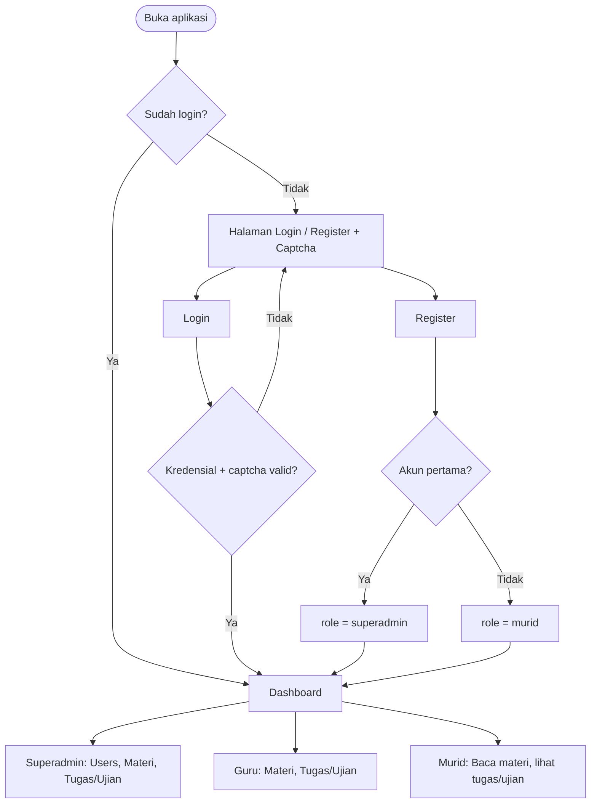

<div align="center">

# 🎓 StaffWork

**LMS (Learning Management System) Starter Kit untuk Sekolah**

Bangun sistem informasi manajerial & pendidikan dengan cepat: autentikasi + captcha, multi-role, materi blog, serta tugas & ujian pilihan ganda.


</div>

---

## 📑 Daftar Isi

- [Ringkasan](#-ringkasan)
- [Fitur Utama](#-fitur-utama)
- [Role & Hak Akses](#-role--hak-akses)
- [Alur Aplikasi](#-alur-aplikasi)
- [Kebutuhan Sistem](#-kebutuhan-sistem)
- [Instalasi](#-instalasi)
- [Struktur Project](#-struktur-project)
- [Panduan Pengembangan](#-panduan-pengembangan)
- [Konfigurasi Environment](#-konfigurasi-environment)
- [Testing & Code Style](#-testing--code-style)
- [License](#-license)

---

## 🔎 Ringkasan

StaffWork adalah *starter kit* LMS berbasis Laravel yang dirancang agar sekolah (atau pengembang yang melayaninya) bisa langsung memiliki fondasi sistem pembelajaran, lalu mengembangkannya sesuai kebutuhan.

| Aspek | Keterangan |
|-------|------------|
| **Tujuan** | Fondasi LMS sekolah yang mudah dikembangkan |
| **Pengguna** | Super Admin, Guru, Murid |
| **Konten belajar** | Materi (blog + lampiran file), Tugas/Ujian pilihan ganda |
| **Keamanan login** | Captcha ([mews/captcha](https://github.com/mewebstudio/captcha)), remember me |
| **Frontend** | Blade + Vite + Tailwind |
| **Database** | SQLite (bawaan), MySQL, atau PostgreSQL |

---

## ✨ Fitur Utama

| Fitur | Deskripsi | Super Admin | Guru | Murid |
|-------|-----------|:-----------:|:----:|:-----:|
| 🔐 **Auth + Captcha** | Login, register, logout, remember me, refresh captcha via AJAX | ✅ | ✅ | ✅ |
| 👥 **Manajemen User** | Daftar, buat, edit, hapus akun beserta role & avatar | ✅ | ❌ | ❌ |
| 📚 **Materi (Blog)** | Tulis/upload materi + lampiran file | ✅ | ✅ | 👁️ baca |
| 📝 **Tugas & Ujian PG** | Soal pilihan ganda (A–D), jawaban benar, durasi, jadwal | ✅ | ✅ | 👁️ lihat |
| 👤 **Profil** | Ubah data diri, password, dan avatar | ✅ | ✅ | ✅ |
| 📊 **Dashboard** | Ringkasan akun per role, jumlah materi & tugas/ujian | ✅ | ✅ | ✅ |

> **Legenda:** ✅ akses penuh · 👁️ hanya melihat · ❌ tidak ada akses

---

## 🛡️ Role & Hak Akses

| Role | Keterangan | Middleware |
|------|------------|------------|
| `superadmin` | Akses penuh: kelola akun, upload materi, buat tugas/ujian | `superadmin` (`EnsureSuperAdmin`) |
| `guru` | Upload materi (blog + file), buat & kelola tugas/ujian pilihan ganda | `teacher` (`EnsureTeacher`) |
| `murid` | Akses belajar: baca materi, lihat tugas/ujian | `auth` |

> 💡 **Catatan penting**
> - Akun pertama yang mendaftar lewat `/auth/register` otomatis menjadi `superadmin`.
> - Role berikutnya dibuat oleh Super Admin di menu **Users**.
> - Middleware `teacher` = **superadmin + guru**.

---

## 🔄 Alur Aplikasi

### 1. Alur Autentikasi & Pembagian Role

```
                      ┌──────────────────────┐
                      │   Pengguna membuka   │
                      │      aplikasi        │
                      └──────────┬───────────┘
                                 │
                                 ▼
                    ┌────────────────────────┐
                    │  Sudah login / punya   │── Ya ──────────┐
                    │  sesi (remember me)?   │                │
                    └────────────┬───────────┘                │
                                 │ Tidak                      │
                                 ▼                            │
                    ┌────────────────────────┐                │
                    │  Halaman Login/Register│                │
                    │   (+ Captcha, bisa     │                │
                    │    di-refresh AJAX)    │                │
                    └────────────┬───────────┘                │
                                 │                            │
                  ┌──────────────┴──────────────┐             │
                  ▼                             ▼             │
        ┌──────────────────┐         ┌──────────────────┐     │
        │     REGISTER     │         │      LOGIN       │     │
        └────────┬─────────┘         └────────┬─────────┘     │
                 │                            │               │
                 ▼                            ▼               │
        ┌──────────────────┐         ┌──────────────────┐     │
        │ Akun pertama di  │         │ Validasi kredensial│    │
        │ sistem?          │         │ + captcha        │     │
        └───┬──────────┬───┘         └────────┬─────────┘     │
         Ya │          │ Tidak                │ Valid         │
            ▼          ▼                      │               │
     ┌───────────┐ ┌───────────┐              │               │
     │ role =    │ │ role =    │              │               │
     │ superadmin│ │ murid     │              │               │
     └─────┬─────┘ └─────┬─────┘              │               │
           └──────┬──────┘                    │               │
                  └────────────┬──────────────┘               │
                               ▼                              │
                    ┌────────────────────┐                    │
                    │     DASHBOARD      │◄───────────────────┘
                    └─────────┬──────────┘
                              │
          ┌───────────────────┼───────────────────┐
          ▼                   ▼                   ▼
   ┌─────────────┐     ┌─────────────┐     ┌─────────────┐
   │ SUPERADMIN  │     │    GURU     │     │    MURID    │
   │ Users,      │     │ Materi,     │     │ Baca materi,│
   │ Materi,     │     │ Tugas/Ujian │     │ lihat tugas/│
   │ Tugas/Ujian │     │             │     │ ujian       │
   └─────────────┘     └─────────────┘     └─────────────┘
```

> ℹ️ Pada alur register, akun non-pertama mendapat role default sesuai konfigurasi aplikasi (umumnya `murid`); Super Admin dapat mengubahnya di menu **Users**.

<details>
<summary>📈 Versi Mermaid (otomatis tampil di GitHub/GitLab)</summary>



</details>

### 2. Alur Pembelajaran (Guru → Murid)

```
 ┌─────────────────────────── GURU / SUPERADMIN ───────────────────────────┐
 │                                                                          │
 │   ┌───────────────┐   ┌───────────────┐   ┌──────────────────────────┐   │
 │   │ Buat Materi   │   │ Lampirkan     │   │ Buat Tugas/Ujian PG      │   │
 │   │ (blog)        │──▶│ file (opsional)│  │ • Judul, durasi, jadwal  │   │
 │   └───────────────┘   └───────────────┘   │ • Soal + opsi A–D        │   │
 │                                           │ • Tentukan jawaban benar │   │
 │                                           └──────────────────────────┘   │
 └───────────────────────────────┬──────────────────────────────────────────┘
                                 │ tersimpan di database & storage
                                 ▼
                    ┌────────────────────────┐
                    │  Konten terpublikasi   │
                    │  pada Dashboard        │
                    └───────────┬────────────┘
                                ▼
 ┌──────────────────────────────── MURID ──────────────────────────────────┐
 │   ┌───────────────┐   ┌───────────────┐   ┌──────────────────────────┐   │
 │   │ Login         │──▶│ Baca materi & │──▶│ Lihat daftar tugas/ujian │   │
 │   │               │   │ unduh lampiran│   │ (durasi & jadwal)        │   │
 │   └───────────────┘   └───────────────┘   └──────────────────────────┘   │
 └──────────────────────────────────────────────────────────────────────────┘
```

### 3. Alur Request (Arsitektur Singkat)

```
 Browser ──▶ routes/web.php ──▶ Middleware ──▶ Controller ──▶ Model ──▶ Database
                                    │               │
                                    │               └──▶ View (Blade) ──▶ Browser
                                    │
                         auth │ teacher │ superadmin
```

### 4. Relasi Data (Gambaran)

```
 ┌──────────────┐ 1      N ┌──────────────┐
 │    users     │─────────▶│  materials   │   (materi dibuat oleh teacher)
 │ role, avatar │          └──────────────┘
 │              │ 1      N ┌──────────────┐ 1      N ┌──────────────┐
 │              │─────────▶│    exams     │─────────▶│  questions   │
 └──────────────┘          │ durasi,jadwal│          │ opsi A–D,    │
                           └──────────────┘          │ jawaban benar│
                                                     └──────────────┘
```

> ℹ️ Diagram relasi bersifat konseptual; sesuaikan dengan skema di `database/migrations/`.

---

## 🧰 Kebutuhan Sistem

| Kebutuhan | Versi / Keterangan |
|-----------|--------------------|
| PHP | `>= 8.3` |
| [Composer](https://getcomposer.org/) | Terbaru |
| Node.js & npm | Untuk Vite / Tailwind |
| Database | SQLite (bawaan), MySQL, atau PostgreSQL |

---

## 🚀 Instalasi

### Opsi A — Setup Cepat (Direkomendasikan)

```bash
git clone <url-repo-staffwork> staffwork
cd staffwork

composer setup
```

Script `composer setup` otomatis menjalankan:

| # | Langkah |
|---|---------|
| 1 | `composer install` |
| 2 | Salin `.env.example` → `.env` (jika belum ada) |
| 3 | `php artisan key:generate` |
| 4 | `php artisan migrate --force` |
| 5 | `npm install` & `npm run build` |

### Opsi B — Setup Manual

```bash
composer install
cp .env.example .env
php artisan key:generate

# Database: sesuaikan DB_* di .env (default SQLite)
php artisan migrate
php artisan db:seed   # opsional: buat user contoh

npm install
npm run build
```

### Langkah Wajib Setelahnya

**1. Storage link** (agar avatar & file materi dapat diakses)

```bash
php artisan storage:link
```

**2. Jalankan aplikasi**

```bash
composer dev
# atau terpisah:
php artisan serve
npm run dev
```

Buka 👉 `http://localhost:8000`

**3. Buat akun pertama**

Akses `/auth/register` — akun pertama otomatis menjadi **superadmin**. Buat akun **guru** / **murid** lewat menu **Users**.

---

## 🗂️ Struktur Project

```
staffwork/
├── app/
│   ├── Http/
│   │   ├── Controllers/
│   │   │   ├── AuthController.php        # login, register, captcha
│   │   │   ├── MateriController.php      # CRUD materi blog
│   │   │   ├── ExamController.php        # CRUD tugas/ujian + soal PG
│   │   │   └── UserController.php        # manajemen user
│   │   └── Middleware/
│   │       ├── EnsureSuperAdmin.php
│   │       └── EnsureTeacher.php         # superadmin | guru
│   └── Models/
│       ├── User.php                      # role, isTeacher(), isStudent()
│       ├── Material.php
│       ├── Exam.php
│       └── Question.php
├── database/
│   ├── migrations/                       # materials, exams, questions
│   └── factories/
├── resources/views/
│   ├── auth/                             # login, register
│   ├── pages/
│   │   ├── materis/                      # index, create, edit, show
│   │   ├── exams/                        # index, create, edit, show
│   │   └── users/
│   └── components/
├── routes/web.php
└── tests/Feature/                        # Auth, LMS, Profile, Users
```

| Komponen | Tanggung Jawab |
|----------|----------------|
| `AuthController` | Login, register, logout, refresh captcha |
| `MateriController` | CRUD materi blog + lampiran |
| `ExamController` | CRUD tugas/ujian beserta soal pilihan ganda |
| `UserController` | Manajemen akun, role, dan avatar |
| `EnsureSuperAdmin` | Membatasi akses hanya untuk superadmin |
| `EnsureTeacher` | Membatasi akses untuk superadmin + guru |

---

## 🛠️ Panduan Pengembangan

### Menjalankan Development

```bash
composer dev
# atau terpisah:
php artisan serve
npm run dev
php artisan test --compact
```

### Menyesuaikan Role

| # | Bagian | Lokasi / Tindakan |
|---|--------|-------------------|
| 1 | **Validasi** | `UserController` (`store` & `update`): `in:superadmin,guru,murid` |
| 2 | **Label & badge** | `app/Models/User.php` (`getRoleNameAttribute`, `getRoleBadgeClassAttribute`) |
| 3 | **Form** | Opsi `<option>` di `pages/users/create.blade.php` & `edit.blade.php` |
| 4 | **Helper** | `isTeacher()`, `isStudent()`, `isSuperAdmin()` di model `User` |
| 5 | **Middleware** | `teacher` (`EnsureTeacher`) & `superadmin` (`EnsureSuperAdmin`) di `bootstrap/app.php` |

### Menambah Fitur LMS Baru

```
 ┌───────────┐   ┌────────────┐   ┌─────────┐   ┌─────────┐   ┌───────────┐
 │ Migration │──▶│ Controller │──▶│  Route  │──▶│  View   │──▶│  Sidebar  │
 │  & Model  │   │            │   │         │   │ (Blade) │   │   menu    │
 └───────────┘   └────────────┘   └─────────┘   └─────────┘   └───────────┘
```

| # | Langkah | Perintah / Lokasi |
|---|---------|-------------------|
| 1 | **Migration & Model** | `php artisan make:model X --migration --factory --no-interaction` |
| 2 | **Controller** | `php artisan make:controller XController --no-interaction` |
| 3 | **Route** | Daftarkan di `routes/web.php`; gunakan middleware `auth` + `teacher` bila hanya untuk guru/superadmin |
| 4 | **View** | Buat Blade di `resources/views/pages/`, gunakan layout `layouts.app` serta komponen `sidebar`/`navbar` yang ada |
| 5 | **Sidebar** | Tambahkan menu di `resources/views/components/sidebar.blade.php` |

### Captcha

| Pengaturan | Nilai |
|------------|-------|
| File konfigurasi | `config/captcha.php` |
| Nonaktifkan (testing) | `CAPTCHA_DISABLE=true` di `.env` |

---

## ⚙️ Konfigurasi Environment

| Variabel | Keterangan |
|----------|------------|
| `APP_NAME` | Nama aplikasi |
| `APP_URL` | URL akses aplikasi |
| `DB_*` | Koneksi database (default SQLite) |
| `CAPTCHA_DISABLE` | `true` untuk menonaktifkan captcha |

---

## 🧪 Testing & Code Style

```bash
# Jalankan seluruh test
php artisan test --compact

# Jalankan satu file test
vendor/bin/pest tests/Feature/LmsContentTest.php

# Code style (Laravel Pint)
vendor/bin/pint --dirty --format agent
```

| Cakupan test (`tests/Feature/`) |
|---------------------------------|
| Auth · LMS · Profile · Users |

---

## 📄 License

Dirilis di bawah lisensi **MIT**.
